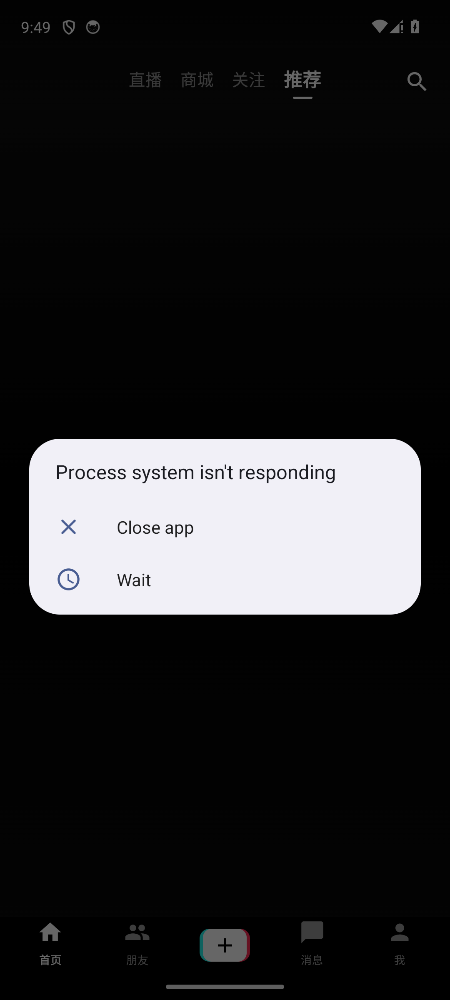
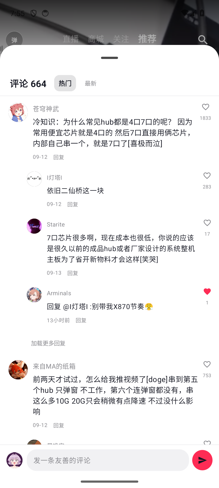
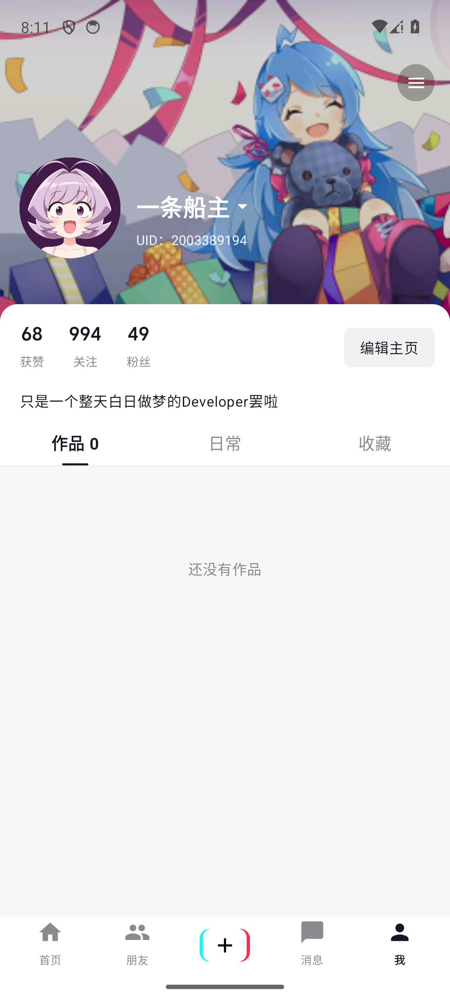

# BiliFlow

第三方哔哩哔哩 Android 客户端：抖音式竖屏沉浸流 + B 站完整互动能力。Kotlin + Jetpack Compose 原生实现，非官方项目，仅供学习交流。

## 功能

- **沉浸视频流**：推荐 / 关注竖屏滑动，预取秒播，DASH 高清 + 兼容流自动回退
- **弹幕**：滚动 / 顶部 / 底部弹幕渲染，发送与 2 分钟内撤回
- **互动**：点赞（双击飘心）、投币、收藏、关注、评论（支持表情包与图片评论）、分享
- **播放**：倍速、清晰度切换、长按 2x、铺满/完整模式、可拖动进度条
- **发现**：搜索、直播、会员购商城
- **账号**：扫码 / 官方安全页登录，消息中心（回复 / 赞 / @ / 粉丝 / 私信 / 系统通知）、私信聊天
- **创作**：应用内选片上传投稿（upos 分片）、个人主页编辑
- **体验**：浅色 / 深色主题、统一弹簧动效体系

## 截图

| 沉浸流 | 评论区 | 个人主页 |
| --- | --- | --- |
|  |  |  |

## 构建

环境：JDK 17、Android SDK 34（minSdk 24）。

```bash
./gradlew assembleDebug    # 调试包
./gradlew assembleRelease  #  release 包（R8 混淆，默认调试签名）
```

安装包也可在 [Releases](../../releases) 页直接下载。

## 技术栈

Kotlin · Jetpack Compose (Material 3) · Media3 / ExoPlayer · kotlinx.coroutines · ZXing

## 声明

- 本项目为非官方第三方客户端，数据来自哔哩哔哩公开 Web 接口，与哔哩哔哩官方无关
- 「哔哩哔哩」商标归上海宽娱数码科技有限公司所有；「抖音」相关设计参考与字体资源归北京微播视界科技有限公司所有
- 登录 Cookie 仅保存在本机，不会上传到任何第三方服务器
- 请勿用于商业用途或侵犯他人权益的场景

## License

[MIT](LICENSE)